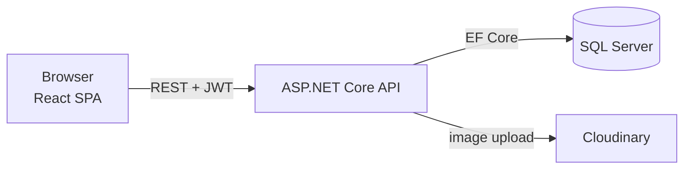

# TechShack: Self-Service Kiosk

A full-stack self-service shopping kiosk: customers browse tech products, reserve items in a timed cart and pay from a digital wallet, and admins manage stock, users and orders from a dashboard.

**Stack:** React 18 · ASP.NET Core (.NET 10) Web API · Entity Framework Core · SQL Server · JWT auth · Docker

<!-- Add 2–4 screenshots or a short GIF here, e.g.:


-->

---

## Try it in one command

Requires [Docker Desktop](https://www.docker.com/products/docker-desktop/).

```bash
cp .env.example .env        # then set SA_PASSWORD and JWT_KEY
docker compose up --build
```

| What | URL |
|---|---|
| Kiosk app | http://localhost:3000 |
| API docs (Swagger) | http://localhost:8080/swagger |

The database is created, migrated and filled with demo data on first start.

**Demo accounts** (password `Demo1234` for all):

| Role | Email |
|---|---|
| Admin | `admin@kiosk.com` |
| Shopper | `becy@kiosk.com`, `stacy@kiosk.com`, `garfield@kiosk.com`, `marie@kiosk.com` |

---

## Features

**Shoppers**
- Browse, search, filter and sort products by category and price
- Timed cart reservation: items are held for the shopper while a countdown shows on every page, and they're released back to stock automatically when time runs out
- Wallet top-ups (capped at R1500 per 24 hours) and wallet-based checkout, with pickup or delivery
- Order history and transaction history

**Admins**
- Dashboard with a 7-day orders chart and recent orders
- Product management (create, edit, delete, toggle availability) with image upload to Cloudinary
- User management: create users, assign roles, top up wallets
- Order and transaction logs
- "Shop for a customer" mode for assisted sales at the kiosk

## Engineering highlights

- **Consistent stock handling:** stock is reserved when an item enters the cart, released on removal or expiry, and never deducted twice at checkout. Wallet charges, orders and stock changes run inside database transactions.
- **Server-side authorization:** JWT authentication with ASP.NET Identity roles. Every money-moving endpoint takes the user from the token, not from the request body, so users can't act on another user's account or order.
- **Tested:** 78 xUnit tests across all controllers (Moq, FluentAssertions, EF Core InMemory), including regression tests for the checkout, payment and top-up rules.
- **Shared UI design system:** design tokens in CSS variables plus shared `Button` and `Modal` components (accessible: focus handling, Escape to close, ARIA roles).
- **Production-minded config:** no secrets in the repository (user-secrets locally, environment variables in Docker), config-driven CORS, health endpoint, structured logging with Serilog.

## Architecture



| Folder | What's inside |
|---|---|
| [`tech-kiosk-fr/`](tech-kiosk-fr) | React app: `pages/` (shopper), `Admin/` (admin), `components/ui/` (shared design system), `context/` (cart timer) |
| [`KioskAPI/`](KioskAPI) | Web API: `Controllers/`, `Models/`, `Dtos/`, `Data/` (DbContext, migrations, demo seed), `Services/` |
| [`KioskAPI.Tests/`](KioskAPI.Tests) | xUnit test suite |
| [`docs/`](docs) | Detailed docs: API endpoints, auth flow, frontend structure, deployment |

## Local development (without Docker)

**Requirements:** .NET 10 SDK, Node 20+, and SQL Server (local or in Docker).

```bash
# 1. API: store secrets outside the repo
cd KioskAPI
dotnet user-secrets set "ConnectionStrings:DefaultConnection" "Server=localhost,1433;Database=kiosk;User Id=sa;Password=<your-password>;TrustServerCertificate=True"
dotnet user-secrets set "Jwt:Key" "$(openssl rand -base64 48)"
# optional, for image uploads:
dotnet user-secrets set "Cloudinary:CloudName" "<name>"
dotnet user-secrets set "Cloudinary:ApiKey" "<key>"
dotnet user-secrets set "Cloudinary:ApiSecret" "<secret>"

dotnet tool install --global dotnet-ef   # once
dotnet ef database update
dotnet run --launch-profile https        # https://localhost:5016/swagger

# 2. Demo data (optional): run KioskAPI/Data/Seed/DemoData.sql against the database

# 3. Frontend
cd ../tech-kiosk-fr
npm install
npm start                                # http://localhost:3000
```

The frontend reads the API address from `REACT_APP_API_URL` (default `https://localhost:5016/api`). See [`tech-kiosk-fr/.env.example`](tech-kiosk-fr/.env.example).

## Running the tests

```bash
dotnet test KioskAPI.Tests
```
